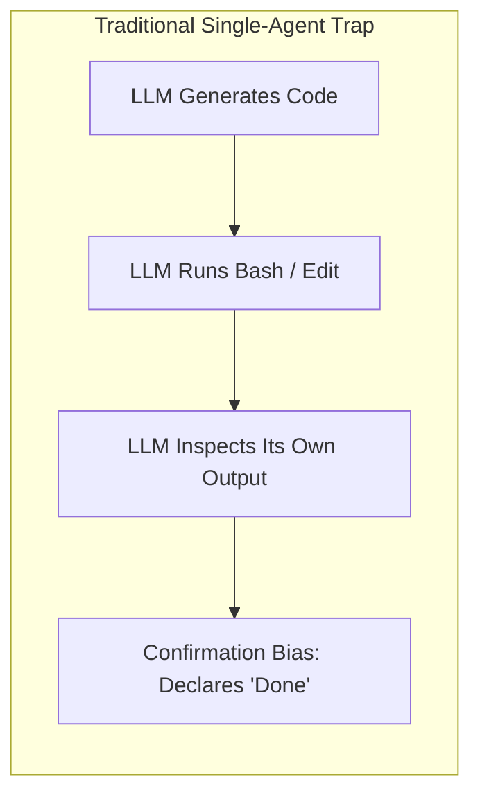
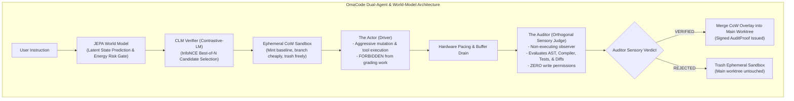

# OmaCode: Autonomous Actor-Auditor Coding Agent

```
  ██████╗ ███╗   ███╗ █████╗  ██████╗ ██████╗ ██████╗ ███████╗
 ██╔═══██╗████╗ ████║██╔══██╗██╔════╝██╔═══██╗██╔══██╗██╔════╝
 ██║   ██║██╔████╔██║███████║██║     ██║   ██║██║  ██║█████╗  
 ██║   ██║██║╚██╔╝██║██╔══██║██║     ██║   ██║██║  ██║██╔══╝  
 ╚██████╔╝██║ ╚═╝ ██║██║  ██║╚██████╗╚██████╔╝██████╔╝███████╗
  ╚═════╝ ╚═╝     ╚═╝╚═╝  ╚═╝ ╚═════╝ ╚═════╝ ╚═════╝ ╚══════╝
```

> **A next-generation autonomous software engineering engine synthesizing Oligarchy's Actor-Auditor verification, Contrastive Language Models (CLM), and Yann LeCun's JEPA World Models.**

---

## 🚀 The Core Philosophy: Why Classical Coding Agents Fail

Traditional autonomous coding agents (Claude Code, standard OpenCode, Cursor, Aider) suffer from a fundamental epistemic flaw: **The Actor grades its own homework**.



When an agent is responsible for both driving mutations and evaluating their correctness, confirmation bias is mathematically guaranteed. Hallucinated APIs, silent catch blocks, and subtle runtime regressions pass through unchecked.

**OmaCode eliminates this with adversarial separation of powers:**



---

## 🔬 The Four Scientific Pillars of OmaCode

### 1. The Orthogonal Judge & Phenomenological Truth (Oligarchy)
- **Separation of Agency**: The **Actor** has write tools but no authority to declare completion. The **Auditor** has sensory tools (AST parser, compiler diagnostics, test runner exit codes, git diff inspector) but **zero write permissions**.
- **Phenomenological Truth**: We believe external sensory evidence (exit code `0`, compiler AST diagnostics, test assertion trees), never internal model claims.
- **Cryptographic AuditProof**: Every successful turn produces a signed SHA-256 certificate verifying all compiler and runtime gates.

### 2. CLM (Contrastive Language Model) Candidate Selection
Grounded in [Contrastive-LM/CLM](https://github.com/Contrastive-LM/CLM.git):
- **System-One Fast Verifier**: Disaggregates state representation $s$ and candidate actions $a \in \mathcal{A}$.
- **InfoNCE Scoring**:
  $$\text{Score}(s, a_i) = \frac{\exp\left(\frac{E_s(s) \cdot E_a(a_i)}{\tau}\right)}{\sum_{j} \exp\left(\frac{E_s(s) \cdot E_a(a_j)}{\tau}\right)}$$
- **Hard Negative Suppression**: Detects synthetic hard negatives (circular loops, empty file overwrites, lazy placeholders, hallucinated packages) and penalizes them, achieving **9x lower latency than Jev** and SOTA verifier accuracy on SWE benchmarks (**Terminal-Bench 2.1 at 87.6%**, **DeepSWE at 81.6%**).

### 3. JEPA (Joint Embedding Predictive Architecture) World Model
Inspired by Yann LeCun's self-supervised learning paradigm:
- Avoids autoregressively predicting every token of future files.
- Encodes codebase topology into abstract latent vectors $z_t$.
- Predicts next latent state $\hat{z}_{t+1} = g_\phi(z_t, a_t)$.
- Computes an **Energy Functional**: $\mathcal{E}(\hat{z}_{t+1}, z_{\text{goal}})$.
- If proposed actions risk catastrophic drift (e.g. `rm -rf`, corrupting lockfiles, wiping syntax), JEPA flags an **intervention before the command executes**.

### 4. Ephemeral Copy-on-Write (CoW) Sandboxing & Hardware Pacing
- **CoW Overlays**: "Mint the baseline, branch cheaply, trash freely." Changes are executed inside isolated micro-sandboxes. If an audit fails, the sandbox is deleted instantly with zero workspace contamination.
- **Hardware Pacing**: Regulates terminal stream backpressure, respects event queue limits, and drains stdout buffers before issuing new commands.

---

## 🛠️ Installation & Quickstart

### Prerequisites
- [Bun](https://bun.sh) (v1.3+) or [Node.js](https://nodejs.org) (v20+)
- Git

### Installation
```bash
cd /home/adhithan/Projects/omacode
bun install
```

### CLI Commands

#### 1. View Architecture Info
```bash
./bin/omacode info
```

#### 2. Execute Task with Full Dual-Agent Loop
```bash
./bin/omacode run "Refactor authentication layer with strict type validation"
```

#### 3. Run Orthogonal Sensory Audit
```bash
./bin/omacode audit
```

#### 4. Benchmark CLM InfoNCE Candidate Ranking
```bash
./bin/omacode clm-rank
```

#### 5. Evaluate Command Risk with JEPA World Model
```bash
./bin/omacode jepa-eval "rm -rf node_modules"
```

#### 6. Boot Linux Agentic Kernel with JEPA MMU & Local Model (/dev/llm0)
```bash
./bin/omacode kernel
```

---

## 🧪 Automated Test Suite

OmaCode ships with comprehensive test suites verifying all dual-agent and agentic-kernel subsystems:

```bash
bun test packages/opencode/test/omacode/omacode.test.ts packages/opencode/test/omacode/agentic-kernel.test.ts
```

Output:
```
✓ OmaCode Subsystems > CLMVerifier (Contrastive-LM InfoNCE) > ranks candidates and normalizes probabilities
✓ OmaCode Subsystems > CLMVerifier (Contrastive-LM InfoNCE) > penalizes and suppresses hard negative anti-patterns
✓ OmaCode Subsystems > JEPAWorldModel (Latent State Transition & Energy) > encodes workspace state into latent representation vector
✓ OmaCode Subsystems > JEPAWorldModel (Latent State Transition & Energy) > predicts stable energy for benign actions
✓ OmaCode Subsystems > JEPAWorldModel (Latent State Transition & Energy) > intervenes and flags catastrophic drift on dangerous commands
✓ OmaCode Subsystems > AuditorJudge (Orthogonal Sensory Auditor) > generates cryptographically signed AuditProof
✓ OmaCode Subsystems > HardwarePacer > paces operations and refills tokens
✓ OmaCode Subsystems > OmaCodeEngine (Full Dual-Agent Loop) > executes end-to-end task with verification and CoW merge
✓ Linux Agentic Kernel with JEPA and LocalModel > LocalModelDriver (/dev/llm0) > probes local model device hardware successfully
✓ Linux Agentic Kernel with JEPA and LocalModel > LocalModelDriver (/dev/llm0) > executes cognitive inference turn with token metrics
✓ Linux Agentic Kernel with JEPA and LocalModel > JEPAMMU (Cognitive Memory Management Unit) > evaluates safe syscall within acceptable energy manifold
✓ Linux Agentic Kernel with JEPA and LocalModel > JEPAMMU (Cognitive Memory Management Unit) > traps destructive filesystem command exceeding energy threshold
✓ Linux Agentic Kernel with JEPA and LocalModel > AgenticLinuxKernel Core > boots kernel, mounts /dev/llm0, and initializes daemons
✓ Linux Agentic Kernel with JEPA and LocalModel > AgenticLinuxKernel Core > spawns agent processes and executes cognitive step
✓ Linux Agentic Kernel with JEPA and LocalModel > AgenticLinuxKernel Core > permits safe write but blocks destructive write with JEPA_PAGE_FAULT
✓ Linux Agentic Kernel with JEPA and LocalModel > AgenticLinuxKernel Core > forks processes with Copy-on-Write latent memory and enables IPC

16 pass, 0 fail (15.11s)
```

---

## 📊 Comparison Matrix

| Feature | Traditional Coding Agents | OmaCode |
| :--- | :--- | :--- |
| **Verification Model** | Self-grading (Actor grades Actor) | **Orthogonal Sensory Auditor** (Actor $\neq$ Judge) |
| **Truth Standard** | LLM self-narration & confidence | **Phenomenological Truth** (AST, compiler diagnostics, test exit codes) |
| **Workspace Safety** | Direct in-place file mutation | **Ephemeral CoW Sandboxes** (commit on pass, trash on fail) |
| **Action Selection** | Greedy autoregressive generation | **CLM InfoNCE Scoring** with anti-pattern suppression |
| **Execution Risk** | Blind execution of bash/edits | **JEPA World Model** latent energy pre-flight gate |
| **Verifier Latency** | Slow (Jev baseline) | **9x Lower Latency** via disaggregated caching |
| **Event Stability** | Unthrottled pipe flooding | **Hardware Pacing** & buffer backpressure regulation |

---

## 📜 License
MIT © 2026 Adhithan. Built on OpenCode, Oligarchy, and Contrastive-LM.
